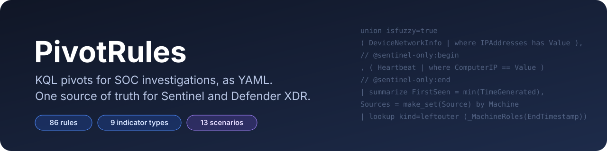
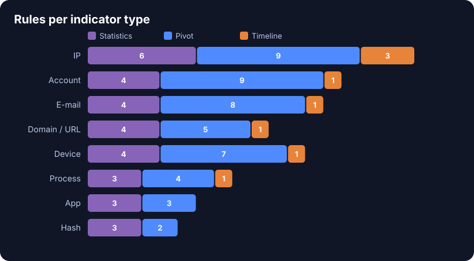
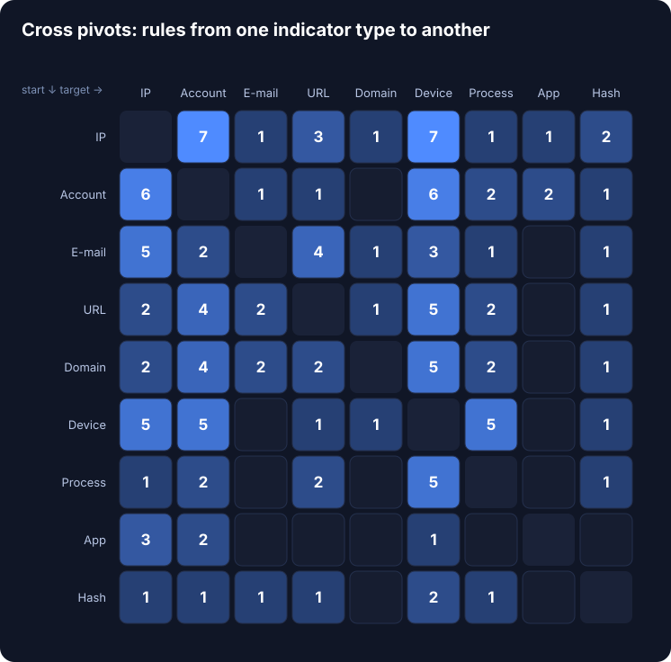
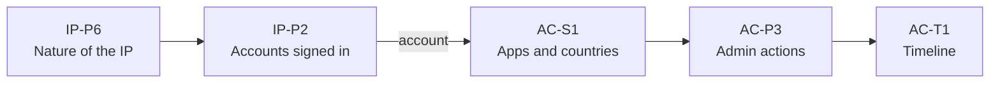

<p align="center">
  
</p>

<p align="center">
  
  
  
  
  
</p>

<p align="center">
  <b>English</b> · <a href="README.fr.md">Français</a>
</p>

**PivotRules** is a library of KQL queries to pivot around the indicators of a SOC investigation on **Microsoft Sentinel** and **Defender XDR**. One rule is one YAML file; the build validates every query with the official Kusto language service and publishes a JSON catalog, read by the [EasyPivot](https://github.com/arthubhub/MicrosoftSentinel-EasyPivot) userscript (right-click a cell → pivot). Full catalog format: [docs/FORMAT.md](docs/FORMAT.md).

```
npm install
npm run build    # dist/pivot-rules.json, dist/pivot-rules.flat.json, dist/CATALOGUE.md
npm test         # strict build + parameter filling + KQL revalidation of every query
npm run assets   # README visuals (docs/*.svg)
```

## At a glance

<p align="center">
  
  
</p>

- **9 indicator types**: IP, account, e-mail, URL, domain, device, process, application, hash.
- **Two variants per rule**: `query` for Sentinel (Log Analytics) and `queryDefender` for Defender XDR, built from a single YAML (`@sentinel-only` / `@defender-only` markers). Every rule has a Defender variant.
- **Cross pivots**: each rule declares the indicator types its result contains (`targets`); the matrix above counts the rules from one type to another.
- **Reading hints**: each rule says what decides, what gives context and what is noise (`reading`).
- **Generated coverage and discovery rules**: which sources are fed, and where a value appears in tables the rules do not read yet.

## Guided scenarios

Rule chains EasyPivot walks through step by step, carrying a value from one step's result to the next (`carry`).


<sub>S1 "Suspicious sign-in from an IP": the labeled arrow carries an account from IP-P2's result.</sub>

| | Scenario | Starts from | Rules |
| --- | --- | --- | --- |
| S1 | Suspicious sign-in from an IP | IP | IP-P6 → IP-P2 ⟶ account → AC-S1 → AC-P3 → AC-T1 |
| S2 | Compromised account | Account | AC-P5 → AC-P1 → AC-P4 → AC-P2 ⟶ device → MC-T1 |
| S3 | Suspicious execution on a device | Device | MC-P5 → MC-P1 → MC-P4 ⟶ hash → HS-P1 ⟶ device → MC-P3 |
| S4 | Phishing | E-mail | EM-P1 → EM-P4 ⟶ URL → DM-P1 ⟶ account → AC-T1 |
| S5 | Malicious domain | Domain | DM-S2 → DM-P4 → DM-P3 ⟶ device → MC-T1 |
| S6 | Lateral movement from a device | Device | MC-P1 ⟶ account → AC-P2 ⟶ device → MC-P6 → MC-T1 |
| S7 | Malicious file | Hash | HS-S1 → HS-P2 → HS-P1 ⟶ device → MC-P3 → MC-T1 |
| S8 | Malicious OAuth consent | App | AP-P1 → AP-P2 → AP-P3 ⟶ account → AC-P4 → AC-P3 |
| S9 | Beaconing to a C2 server | IP | IP-P6 → IP-P4 ⟶ process → PR-P1 → PR-P4 → PR-T1 |
| S10 | Password spray or brute force | IP | IP-S4 → IP-T3 → IP-P2 ⟶ account → AC-S2 → AC-P9 |
| S11 | Account flagged at risk by Entra ID | Account | AC-P9 → AC-S1 → AC-P1 ⟶ IP → IP-P6 → IP-P2 |
| S12 | Data exfiltration by an account | Account | AC-P6 → AC-P3 → AC-P7 → AC-P1 ⟶ IP → IP-P3 |
| S13 | Suspicious outbound traffic from a device | Device | MC-P2 ⟶ domain → DM-S2 → DM-P3 ⟶ device → MC-T1 |

The whole catalog (rule and scenario names, descriptions, reading hints) is written in English; the EasyPivot interface is available in English and French.

## Repository layout

| Folder | Content |
| --- | --- |
| `rules/<indicator>/*.yaml` | KQL rules, one per file |
| `scenarios/S<n>.yml` | Guided scenarios |
| `fragments/*.kql` | Shared KQL functions, inserted in the rules that list them in `uses` (`_Signins`, `_IpEvents`, `_WinSecurity`, `_Sysmon`, roles…) |
| `indicators/<type>/locations.yml` | Columns where each indicator type can appear (detection, discovery) |
| `schema/` | Rule schema, columns of the standard tables, source families (`sources.json`), Defender XDR overrides |
| `schemas/` | Versioned schemas of the standard tables (no custom `_CL` table) |
| `scripts/` | Compiler (`build.mjs`), Kusto validator, tests, generators, README visuals |
| `docs/FORMAT.md` | Published catalog format ([French version](docs/FORMAT.fr.md)) |

## Rule format

```yaml
id: IP-P2                      # indicator prefix + (S)tatistics/(P)ivot/(T)imeline + number
name: Accounts signed in from the IP
indicators: [ip]
action: pivot                  # statistics | pivot | timeline
targets: [account]             # indicator types present in the result (cross pivots)
description: >
  What the query shows and from which sources.
reading:
  decisive: what settles the question
  context: what points in a direction without settling it
  noise: what is normal in a healthy environment
window: { before: 24h, after: 1h }   # default window around T0
uses: [signins, win_security]  # fragments (dependencies are resolved)
query: |
  _Signins(StartTimestamp, EndTimestamp, Value, "")
  | ...
```

Inside `query`: `Value`, `T0`, `StartTimestamp`, `EndTimestamp`, indicator-derived variables (`ValueUpn`, `ValueSam`, `ValueDomain`, `ValueHash`…), and the functions of the declared fragments.

**Sentinel and Defender from one file.** Lines between `// @sentinel-only:begin` and `// @sentinel-only:end` are removed from the Defender variant (branches reading tables Defender XDR does not have: ASIM, Syslog, SecurityEvent…). Lines between `// @defender-only:begin` and `// @defender-only:end` are kept only in the Defender variant (an XDR branch that would duplicate a Sentinel one). `TimeGenerated` becomes `Timestamp` for Defender. The build checks that each Defender variant reads only XDR tables.

## Source coverage and discovery

A missing table raises no error (`union isfuzzy=true` skips it): the rule just returns fewer rows. So:

- **Source families** (`schema/sources.json`) group tables (or channels and event IDs of a table) that see the same events. The build refuses a rule reading a table outside a family.
- **Generated coverage rules** `XX-S0` check, on your workspace, each source the rules of an indicator actually read: present, fed, events collected, columns present, compensated by an equivalent source or not, and what to enable. Run them first on a new environment.
- **Equivalent sources without duplicates**: `SigninLogs` / `EntraIdSignInEvents`, `AADServicePrincipalSignInLogs` / `EntraIdSpnSignInEvents`… the fallback table is read only for what the main one lacks.
- **Generated discovery rules** `XX-S9` look for the value in every table (`union * | where * has`) and compare each location with the columns the rules read. A location "not read by the rules" is a source to add; EasyPivot can prefill the issue for you.
- **Entity roles** (`fragments/roles.kql`): domain controllers detected automatically, IdentityInfo roles, and an optional `EasyPivotRoles` watchlist, so a DC, a NAT or a service account is labeled instead of misleading.

## Query parameters

Each compiled query starts with `// [ID] name` and a header that stays valid KQL before substitution:

| Parameter | Replaced by | Default |
| --- | --- | --- |
| `{{VALUE}}` | The pivoted value, in a verbatim string `@"…"` | — |
| `{{T0}}` | ISO 8601 time of the event | `now()` |
| `{{BEFORE_MIN}}`, `{{AFTER_MIN}}` | Window in minutes | the rule's `window` |
| `{{HOST}}` | Device of the row (process and hash rules) | all devices |

## Contributing

One rule = one YAML file.

1. Fork, branch, `npm ci`.
2. Add a file following the format above; the `id` is unique and is the file name (`rules/ip/IP-P10.yaml`). `XX-S0` and `XX-S9` are reserved.
3. Fill `reading` and `targets`, reuse fragments, put Sentinel-only branches in `@sentinel-only` blocks, add any new table to a family in `schema/sources.json`.
4. `npm test` must print 0 error and 0 warning; check your rule in `dist/CATALOGUE.md`.
5. Open a pull request describing the investigation scenario. Never put real data (values, customers, tenants) in queries or examples; custom `_CL` tables are not accepted.

A missing log source can be reported with the "Missing log source" issue form, which EasyPivot prefills from a discovery result (type, table, column, platform only).

## Getting the output

Each push to `master` builds and publishes a release:

| File | Use |
| --- | --- |
| `pivot-rules.json` | Full catalog: indicators, patterns, actions, parameters, reading hints, locations, scenarios, Sentinel and Defender XDR queries |
| `pivot-rules.flat.json` | Legacy format `[{ name, category, description, query }]` |
| `CATALOGUE.md` | Human-readable catalog, with the cross-pivot matrix and the scenarios |

```
https://github.com/arthubhub/MSSentinel-PivotRules/releases/latest/download/pivot-rules.json
https://github.com/arthubhub/MSSentinel-PivotRules/releases/latest/download/pivot-rules.flat.json
https://github.com/arthubhub/MSSentinel-PivotRules/releases/latest/download/CATALOGUE.md
```
